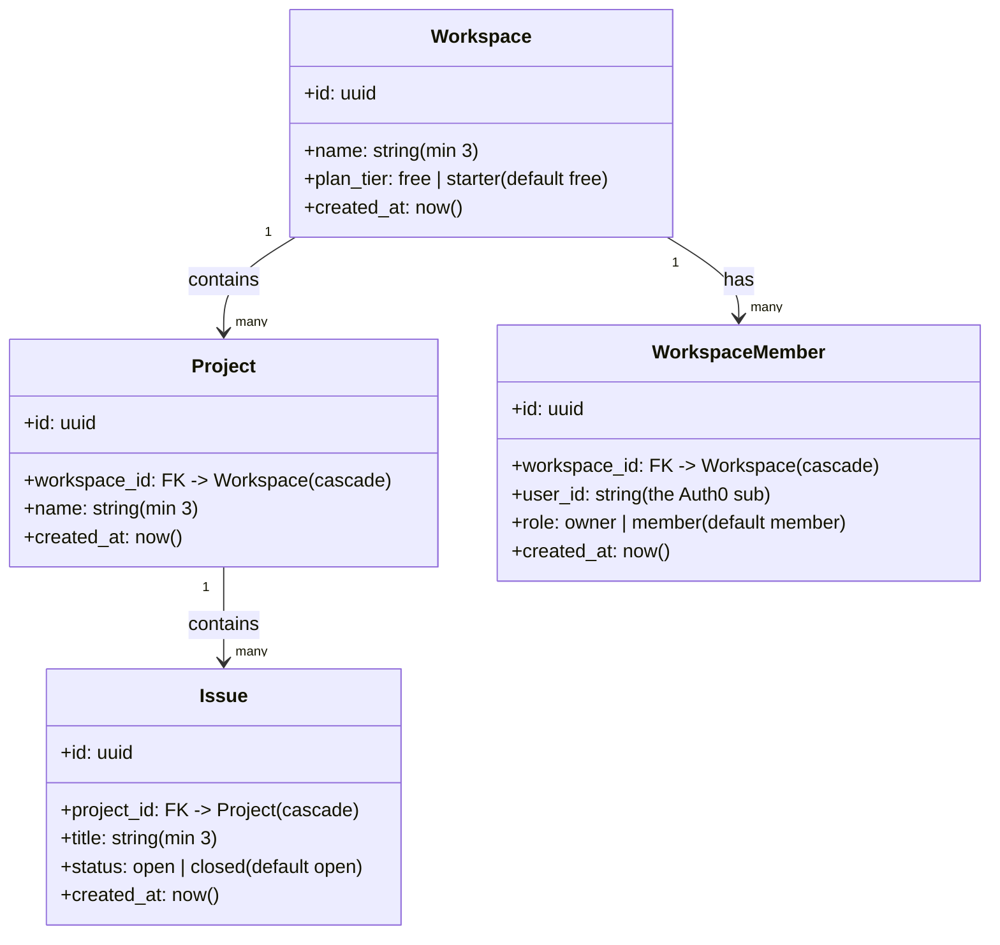

# TaskFlow — Product

> **Status**: Draft · **Date**: 2026-10-10 · **Owner**: user + AI · **App**: #1 of the foundry
> **The spec** — what it is, who it's for, why it feels good. *Stable; no sequencing, no "next."*
> **Companion**: `taskflow-build.md` — the *ledger* (how we build it + prove it's right). **That** doc drives the roadmap; this one is the north star it points toward.
> **Grounded in**: `apps/taskflow/py/` + `apps/taskflow/ts/` (the two kitchens), `docs_v2/debt.md` (what's owed)
> **House rule honored**: where this doc and the code disagree, **the code wins** — then fix the doc the same day (ADR-013).

---

## 1. The product in one paragraph

**TaskFlow is a small, self-hostable task-management SaaS.** A person signs in with their own identity (Auth0), creates a **workspace** (a private room for their work), fills it with **projects**, and tracks the individual **issues** inside those projects. Workspaces have **members** with **roles**, and workspaces have a **plan tier** — the seam where a free workspace and a paid one become *different products*.

It is deliberately a **Linear-clone**: not a new idea, but a *known-shape* product used as the foundry's proving ground for the harder, reusable things — multi-tenant access control, a dual-language parity wall, and a billing/plan state machine.

**The restaurant** (the house metaphor, kept on purpose): TaskFlow is a restaurant. The **door** is Auth0. The **waiter** is the route layer. The **chef** is the business logic. The **fridge** is Postgres ("the cellar"). The **badge reader** checks *who* you are; the **key-ring** (RBAC) checks *which rooms* you may enter; the **cashier** (Razorpay, next) takes money. And the whole restaurant is built in **two kitchens** — TypeScript and Python — that must serve **byte-identical dishes**.

---

## 2. Why this product

From the roadmap's vision: build a *complete software-engineering business* as a solo developer — real product, real infra, real revenue — with a 10+ year lifespan. TaskFlow is the vehicle that lets the foundry practice the three phases in order (**Make it Work → Make it Right → Make it Fast**) on a product with a *known shape*, so the effort goes into the *infrastructure and discipline*, not into inventing the product.

- **Make it Work** (Sprint 1-2): a deployed URL you can `curl`; sign in; create/read/update/delete workspaces, projects, issues. ✅ *mostly here*
- **Make it Right** (Deepenings 1-3): tests, DDD, multi-tenant RLS, K3s/Helm/GitOps, microservices. ⏳ *ahead*
- **Make it Fast** (Deepenings 4-5): p99 budgets, autoscaling, observability, DR. ⏳ *later*

TaskFlow is the *thing that proves the foundry can do all three*.

---

## 3. Who it's for

| Persona | What they need | What TaskFlow gives them today |
|---|---|---|
| **The owner** (payer) | A private room for their team's work; control over who's inside; the ability to *pay* for more | Creates a workspace (auto-minted `owner`), invites members, manages projects/issues, will *buy* a tier |
| **The member** (invitee) | Read their team's work; write within their tier's allowance | Sees only their own workspaces/projects/issues (scoped list); writes gated by role + plan tier |
| **The stranger** (valid badge, no membership) | Nothing — they should see nothing | Gets `[]` on list routes; `403` on item routes |
| **The operator** (you, solo dev) | A product that runs on a $0 VM, in two languages, with a parity wall that *fails the build* on drift | docker-compose deploy; golden-matrix tests; CI that ships cellar-less and key-less |

---

## 4. The domain model

Four entities, in a strict hierarchy. *(Grounded in `py/src/models.py` / `ts/src/db.ts` — identical on both tracks.)*

**The rules that make it multi-tenant:**
- **Hierarchy is the ownership chain.** `issue → project → workspace → members`. There is no "global" object; everything hangs off a workspace.
- **Cascade delete down the chain.** Delete a workspace and its projects, issues, and memberships all fall (FK `ondelete='cascade'`).
- **One membership per (workspace, user).** `UNIQUE(workspace_id, user_id)` — you can't be invited twice.
- **Role is a closed set.** `CHECK role IN ('owner','member')` — enforced in the cellar, not just the app.
- **IDs are UUIDs** (the `generate_id()` seam, ADR-003) — not auto-increment, so they're safe to expose.

**The plan tier** (`workspaces.plan_tier`, `free | starter`, default `free`) is the *billing* column. It is the seam the day-10 note named: *"the moment a payer exists, the two roles become the two products."* How that seam is wired is the build story — see `taskflow-build.md` §2 (the plan & the money).

---

## 5. The experience (UX) — how it *feels*

The domain model (§4) is the *what*. This is the *how it feels* — and it is not decoration. Linear's own words for what it sells: **"Designed for speed — reduces noise and restores momentum."** That sentence is the whole UX thesis. This section turns it into *requirements*: each flow is a real moment from a real person's day, and each ends with a **signal** — a number we can measure — so the experience is *tested*, not *re-read* (the same discipline as the golden matrix in the build doc §4, aimed at experience instead of bytes).

### 5.1 The standing UX laws (always in force)

Six laws that apply to *every* screen, not just the flows below. They are the spine.

| Law | What it means | Why (the psychology, in plain words) |
|---|---|---|
| **Speed is a feature** | Render before the data is fully synced; load the rest in the background | Perceived speed → trust. NN/g: under **0.1s** feels like *direct* control; **1s** keeps your flow unbroken; past **10s** you owe a progress bar + a way out |
| **Keyboard-first** | The command palette (`Cmd/Ctrl+K`) is the primary surface, not the mouse | **Fitts's Law** — a key is faster than mouse travel; muscle memory + no context switch = **flow** |
| **Calm density** | Dense but restrained: one accent color, generous whitespace, no visual shouting | **Aesthetic-usability effect** — people judge a clean interface as *more usable*; clutter adds **extrinsic cognitive load** |
| **Optimistic action** | The UI updates the instant you act; the server confirms in the background | **Agency** — you feel in control; the spinner is the enemy of perceived speed |
| **Quiet by default** | No popups, no toasts that interrupt; notifications batch and wait | **Attention residue** — every interruption leaves a cost; the brain pays to re-orient |
| **Consistent & predictable** | The same gesture does the same thing everywhere | A stable **mental schema** means zero re-learning; predictability is what makes speed *feel* safe |

> **The render-before-sync rule** (Linear's live "faster app launch" change): show the UI as soon as the *minimum* state is present, then hydrate the rest in the background. Completeness is not the goal — *momentum* is.

### 5.2 The flows (each is a requirement)

Two flows are the **heartbeat** of a task tool and get the full treatment — **Capture** and **Status flow**. Four supporting flows get the lighter version.

#### 5.2.1 Capture — *the hero*

**The moment.** It's 9:04 AM. You're mid-thought in a design doc. A teammate drops into Slack: *"checkout button's misaligned on mobile."*

- **In a typical tool**, you stop, open a tab, hunt for "New Issue," and meet a form — *title? description? assignee? priority? project? status?* — save, come back. That's **four context switches** and ~90 seconds, and the thought that started it is now cold.
- **In Linear**, you press `C`, type the sentence, hit enter. **Three seconds.** The issue exists. You're back in your doc.

| What you just saw | The Linear feature (business evidence) | Why it's shaped that way |
|---|---|---|
| Press `C` from *anywhere* | **Keyboard-first** — the palette is Linear's core identity | **Fitts's Law** + **flow** — a key beats mouse travel; no tab switch breaks momentum |
| Type a sentence, not a form | **Natural-language capture** — Linear parses the line into title/labels/assignee | **Close the open loop fast** (Zeigarnik) — an un-captured task nags; the goal is *out of your head* in seconds, not a form to fill |
| It appears before the server confirms | **Optimistic UI** — the list updates instantly, reconciles behind the scenes | **Perceived speed** — under 0.1s feels like *direct* manipulation; no spinner, so it *feels* instant |
| It lands in Triage, already labeled | **Auto-triage** — the AI suggests a label/priority/project at creation | **Fewer decisions now** (Hick's Law) — the hard triage call is *deferred*, not front-loaded |

**The signal.** Time-to-capture (target **< 5s**) and *return-to-work* — did you go back to your doc, or did the capture eat your focus?

#### 5.2.2 Status flow — *the hero*

**The moment.** It's 2:15 PM. You're 80% done with a fix, but the issue still sits in **Todo**. You keep glancing at it. It's nagging — not because it's hard, but because it's *open*.

- **In a typical tool**, moving it means clicking into the issue, finding a status dropdown, picking "In Progress," saving. You did that *twice* already today.
- **In Linear**, you hover the row and press `W` (or click the status pill). One keystroke. It's moving.

| What you just saw | The Linear feature (business evidence) | Why it's shaped that way |
|---|---|---|
| A visible pipeline: `Backlog → Triage → Todo → In Progress → Done` | **Linear's status model** — the column *is* the state; you see the whole shape at once | **Externalized working memory** — you don't hold the state in your head; the board holds it |
| One key / one click to advance | **Keyboard-driven status** — `W` cycles, or a single click on the pill | **Goal-gradient effect** — we *accelerate* near a goal; a one-keystroke hop makes "done" feel close, so we finish |
| The row updates instantly, no reload | **Optimistic UI** | **Perceived speed** — the hop *feels* immediate, so moving work has no friction |
| "Done" is a real, satisfying state | **Done is terminal** — resolved issues leave the active view | **Close the loop** (Zeigarnik) — the nag stops only when the task is *done*, not just "moved" |

**The signal.** **Cycle time** (time in each column) and **WIP** (work-in-progress count) — a healthy board has *few* things in-flight and *fast* hops.

#### 5.2.3 Triage — *supporting*

**The moment.** Monday 9:00. You open the board and **Triage has 40 open issues**. Your brain wants to close the tab.

| What you just saw | The Linear feature | Why |
|---|---|---|
| One Triage column, not a wall of 40 | **A single intake lane** | **Hick's Law** — 40 choices is paralysis; one lane with a *sort* is a decision you can make |
| AI pre-sorts by likely priority/project | **Auto-triage** | **Externalized judgment** — the machine does the first pass; you *confirm*, not *decide from zero* |
| One key to advance or defer | **Keyboard triage** | **Flow** — the goal is to *clear the lane*, fast, without the mouse |

**The signal.** Median **time-in-triage** — a lane that drains is a team that isn't stuck.

#### 5.2.4 Navigate — *supporting*

**The moment.** You want the "checkout button" issue but can't remember which project it's in.

| What you just saw | The Linear feature | Why |
|---|---|---|
| `Cmd+K`, type 3 letters, arrow, enter | **Fuzzy command palette** | **Fitts's Law** + the **Doherty threshold** — search beats navigation; you never leave the keyboard |

**The signal.** **Actions per minute** — the throughput of a keyboard-first user.

#### 5.2.5 Recover from error — *supporting*

**The moment.** You try to delete a project and it just says **"Error."** You don't know if it failed, if you lack permission, or if the network died. You try again. It fails again. You're stuck.

| What you just saw | The Linear-style behavior | Why |
|---|---|---|
| The error names *what happened* **and** the next step | A human message, not a code — e.g. *"You need the owner role to delete this"* | **Peak-end rule** — an error is a *peak* moment; how it ends shapes how the whole session is remembered. **Agency** — naming the next step hands the fix back to you |

**The signal.** **Error → recovery time** — how fast a person gets unstuck after a failure.

#### 5.2.6 First run — *supporting*

**The moment.** You just signed up. It's a **blank screen.** You don't know what to do first.

| What you just saw | The Linear-style behavior | Why |
|---|---|---|
| Empty states that *teach*; a sample workspace to poke at | **Scaffolded onboarding** | **Activation energy** — a blank canvas is a high barrier; a worked example lowers it. **Aesthetic-usability** — the first impression is the perceived-usability verdict |

**The signal.** **Time-to-first-issue** — how fast a new user does the one thing that makes the tool real.

---

## 6. Non-goals (what TaskFlow is *not*)

- **Not a new product idea.** It's a Linear-*clone* chosen for its known shape; the value is in the infrastructure it exercises.
- **Not a single-language app.** The two-kitchen parity wall is a *requirement*, not an accident.
- **Not a public SaaS (yet).** It's self-hostable and multi-tenant-ready; a real multi-customer public launch is a later deepening.
- **Not a performance project (yet).** "Make it Fast" is explicitly *after* "Make it Right."
- **Not a place to share code across kitchens.** The parity wall forbids it.
