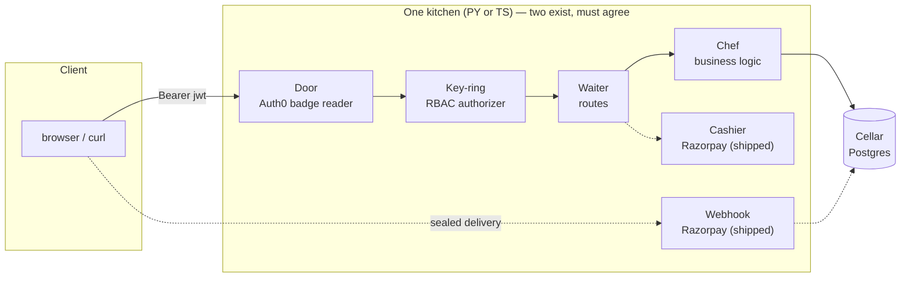

# TaskFlow — Build

> **Status**: Draft · **Date**: 2026-10-10 · **Owner**: user + AI · **App**: #1 of the foundry
> **The ledger** — how we build it + prove it's right. *This* doc drives the roadmap (state + sequence).
> **Companions**: `taskflow-product.md` — the *spec* (what it is, who it's for, why it feels good). `design-pattern-ledger.md` — the *how it's built* (which patterns are in use, why, and the swap story each buys). Read the spec first for the *why*; this is the *how* (sequence), and the ledger is the *how* (shape).
> **Grounded in**: `apps/taskflow/py/` + `apps/taskflow/ts/` (the two kitchens), `docs_v2/debt.md` (what's owed), `docs/roadmaps/v4/master.md` §16 (current position)
> **House rule honored**: where this doc and the code disagree, **the code wins** — then fix the doc the same day (ADR-013).

---

## 1. The access story (the load-bearing part)

Three layers, in order. **A request must clear all three.** *(Grounded in `auth.py`/`authorize.py` + the TS twins.)*

### 1.1 The door — Auth0 badge reader (ADR-011)
- One **global** choke point (a single door, not per-room doors).
- Verifies the JWT against the tenant's **JWKS** (cached; re-fetches *exactly once* on an unknown `kid`).
- **Fail-closed**: any verification problem → `401`, never a silent pass.
- **Doorless mode**: if `AUTH0_DOMAIN` is unset, the door opens (local dev / CI).
- **Six fixed 401 strings** (the contract; identical on both kitchens): `No token provided`, `Malformed token`, `Token expired`, `Wrong audience`, `Wrong issuer`, `Signature verification failed`.
- **Tenant allowlist**: a per-request `x-tenant-domain` override is untrusted input — a stranger tenant fails closed.

### 1.2 The key-ring — RBAC authorizer (ADR-012)
- **Two roles, rank-ordered**: `member` (rank 1) < `owner` (rank 2). A *ladder*, so a third role can slot in later without reshaping the logic.
- **One pure decision function** (`assert_role`) — no HTTP, no session of its own; the caller hands it the single membership read. This is the unit-test seam (cellars apart).
- **Two fixed 403 strings** (the contract; identical on both kitchens): `Not a member of this workspace`, `Requires the owner role`.
- **Middleware-only enforcement** — the routes stay clean; the *shape* of enforcement is decided in one place.

### 1.3 The gate table (what each route requires)

| Route | Method | Minimum role | Notes |
|---|---|---|---|
| `/` | GET | public | lighthouse / health |
| `/workspaces` | GET | — (scoped) | returns **only the caller's** workspaces |
| `/workspaces` | POST | — (creator) | creator is **minted `owner`** in one transaction |
| `/workspaces/{id}` | GET | member | |
| `/workspaces/{id}` | PATCH | owner | |
| `/workspaces/{id}` | DELETE | owner | cascades |
| `/workspaces/{id}/members` | POST | owner | invite; `409` if already a member |
| `/workspaces/{id}/members` | GET | member | empty list = `200 []`; missing workspace = `404` |
| `/workspaces/{id}/billing/checkout` | POST | owner | mints a pending `trial` plan (no state change); `503` if unkeyed (ADR-014) |
| `/workspaces/{id}/billing/verify` | POST | owner | on sig match `trial→active` + `plan_tier→starter`; `400` on mismatch (ADR-014) |
| `/projects` | GET | — (scoped) | **only the caller's** projects (walks `project → workspace`) |
| `/projects/{id}` | GET | member | |
| `/projects/{id}` | PATCH | owner | moving to another workspace must name an existing one |
| `/projects/{id}` | DELETE | owner | |
| `/issues` | GET | — (scoped) | **only the caller's** issues (walks `issue → project → workspace`) |
| `/issues/{id}` | GET | member | |
| `/issues/{id}` | PATCH | owner | |
| `/issues/{id}` | DELETE | owner | |

> **The scoping invariant** (the day-10 finding, now a standing golden-matrix test): a *badged* user sees **only their own** workspaces/projects/issues on **both** kitchens (8000 == 8001); a *stranger with a valid badge* (a member of a *different* workspace) gets **`[]`** on all three list routes.

---

## 2. The plan & the money (the seam, and the next build)

This is where TaskFlow stops being a toy and becomes a *business*. It has three parts — the **checkout** (day-15) and the **webhook** (day-16) — **all shipped**; the live round-trip is the named debt (16a).

### 2.1 Shipped: the plan tier column
`workspaces.plan_tier` exists on **both** tracks (`free | starter`, default `free`). It is the *data* half of the story — and since day-15 the *other* half reads it: the authorizer's plan→role link (ADR-014, Decide-4) couples the tier to the role ladder. The tier is **system-managed**: only the plan state machine (the checkout) writes it; it is never client-settable.

### 2.2 The intent (the day-10 contract, do not lose it)
> *"the moment a payer exists, the two roles become the two products."*

- **Free tier** → a workspace's `member` is **read-only**.
- **Paid (starter) tier** → a workspace's `member` **may write**.

The RBAC layer was *built to unlock exactly this*. **Wired day-15 (ADR-014, Decide-4)**: the `plan_tier` input inside `assert_role`/`assertRole` — free member read-only, starter member may write — so the money story *compounds* instead of the two decoupling.

### 2.3 Shipped: the plan state machine (fully wired, day-16) + the Razorpay checkout (day-15)
The full subscription lifecycle, modeled on **Ghost's content-states**:

```
trial  →  active  →  past_due  →  canceled
          ↑___________|  (recovered)
```

- **Create order** → **verify payment** (Razorpay; HMAC/SHA-256 signature check — a *pure* function, faked in tests).
- **The cashier sits *above* the door and the key-ring** — it reuses the *same* `sub` the authorizer reads and the *same* ADR-012 authorizer, so a stranger is stopped at the door (`401`) and a non-owner before the money leaves (`403`). The reader, the door, the 401/403 contracts, and the lighthouse set stay **untouched**.
- **The testable core is pure** (no network, cellar): the state machine transitions + the signature verify. The *live* round-trip (real order, real webhook) is the local bar — the **named debt** class, mirroring ADR-011's live-JWKS.

### 2.4 Shipped (day-16): the webhook — the ledger's full life (ADR-015)
- **A public route** (`/webhooks/razorpay`) that *bypasses the door* — Razorpay calls it without a badge; it authenticates by **HMAC-SHA256 over the raw body** (a second, sealed-delivery auth, distinct from the JWT door; the door stays untouched for every other route).
- **The event map** — a static lookup from Razorpay `event.name` → machine event; the state table disambiguates (`trial+paid`=activate, `past_due+paid`=recover).
- **All three ADR-014 edges now fire**: `active→past_due` (`payment.failed`), `past_due→active` (recovery), `any→canceled` (unsubscribe); `canceled` is terminal.
- **Idempotent + always-200** (except `503` unkeyed / `400` bad sig) so Razorpay never retries a business no-op; the tier syncs (`active→starter`, `canceled→free`, `past_due→keep`).
- **Fail-closed**: missing `RAZORPAY_WEBHOOK_SECRET` → `503`; missing/bad signature → `400`. The *live* delivery (a real test-mode event) is debt 16a.

---

## 3. The error contract (ADR-007)

Fixed strings, identical on both kitchens. This is a *contract* — a client can depend on the exact message.

| Status | When | Message(s) |
|---|---|---|
| `401` | door fails | the **six** strings in §1.1 |
| `403` | key-ring fails | `Not a member of this workspace` · `Requires the owner role` |
| `404` | resource absent | `… does not exist` (entity-specific) |
| `409` | duplicate | e.g. `User … is already a member of this workspace` |
| `500` | cellar crash | `Database op failed internally` (the original error is logged, never leaked) |

**Envelope shape** (both kitchens): `{"statusCode": <n>, "error": "<Name>", "message": "<fixed string>"}`.

**The dead-cellar rule** (ADR-008): a database failure is a **500 with a fixed string** — never a stack trace, never a silent empty. The cellar can die; the contract doesn't.

---

## 4. Architecture & the parity wall

The thing that makes TaskFlow *the foundry's proving ground* rather than just another CRUD app.

- **Two kitchens, one dish (ADR-001).** Python/FastAPI (`py/`) and TypeScript/Fastify+Hono (`ts/`) implement the *same* routes, *same* error strings, and — *intended* — the *same* response shapes. **Never** share code across the kitchens. (The one known wire-level gap is now closed — see the callout below.)
- **The golden matrix is the source of truth for parity.** A shared fixture (same request → same response JSON) that **both** tracks assert. A drift turns the fast suite **red** — parity is *tested*, not *re-read*.
- **The cellar** (ADR-005, ADR-008): Postgres, via SQLAlchemy (PY) / Drizzle (TS). Doorless by default; the dead-cellar 500 is the contract.
- **CI ships cellar-less and key-less** (ADR-010): the *payable* and *auth* tests are the **pure** shape only (state machine, signature verify, role ladder) — no live Razorpay, no live JWKS, no Postgres in CI.
- **Deploy**: `docker compose -f docker-compose.yml -f docker-compose.prod.yml up -d --build` on a $0 Free-Tier VM (the live record is an AWS `a1`-class box, `us-east-1`).

> **✅ Wire-level parity — closed 2026-10-10.** The *type-layer* golden matrix was green on both kitchens, but the *wire* layer had drifted and the matrix did not exercise it: the TypeScript kitchen serialized through **zod response schemas** written before `created_at` / `plan_tier` existed and never updated, and because the app sets `setSerializerCompiler`, Fastify **stripped** those fields — so the two kitchens returned **different JSON** for the same resource, **silent in CI** (the matrix asserted the type *definitions*, which still agreed, not the zod *serializer*). **The fix:** `workspaceSchema` gained `plan_tier` + `created_at`, and `projectSchema` / `issueSchema` gained `created_at` — all in the PY kitchen's key order, so the two kitchens now emit byte-identical JSON. **One correction to the original framing:** `workspaceMemberSchema` was **not** in the gap — the PY `WorkspaceMember` pydantic model has no `created_at` either, so both kitchens already agreed on the member (`{ id, workspace_id, user_id, role }`); adding it would have *broken* parity, so it is left untouched. The golden matrix (`py/tests/test_types.py` + `ts/tests/types.test.ts`) now asserts the *serialized* wire shape (ordered key set + enums) in both tracks, so a serializer drift turns the fast suite red. The kitchens are now *wire*-identical, not just *type*-identical.



---

## 5. What's built vs. what's next (honest state, 2026-10-22)

| Capability | State |
|---|---|
| CRUD: workspaces, projects, issues | ✅ shipped, both kitchens |
| Auth0 door (badge reader, six 401s, fail-closed) | ✅ shipped |
| RBAC key-ring (owner/member ladder, two 403s) | ✅ shipped |
| Multi-tenant scoping (see only your own) | ✅ shipped, golden-matrix guarded |
| **Wire-level response parity** (identical JSON, both kitchens) | ✅ **closed 2026-10-10** — the three trailing zod schemas now match the PY key order; the member was already at parity; the golden matrix asserts the serialized shape in both tracks |
| Plan tier column (`free`/`starter`) | ✅ shipped (system-managed; the authorizer reads it — §2.1) |
| **Plan tier → role capability** (free=read-only, paid=write) | ✅ shipped day-15 (ADR-014 — the `plan_tier` input inside `assert_role`; a derived privilege, not a third role) |
| **Plan state machine** (trial→active→past_due→canceled) | ✅ **fully wired day-16** (pure, tested) — all three edges fire via the webhook (ADR-015) |
| **Razorpay checkout** (create order, verify payment) | ✅ shipped day-15 (ADR-014) |
| **Webhook route** (sealed-delivery auth, event map, always-200) | ✅ shipped day-16 (ADR-015) |
| Webhook / subscription lifecycle (**live** round-trip) | ⏳ named debt 16a (live-Razorpay class) |
| UI in a browser (Sprint 3) | ⏳ ahead |
| Multi-tenant RLS, K3s/Helm/GitOps (Make it Right) | ⏳ ahead |

---

## 6. Open questions (rule 16 — named, not assumed)

1. ~~**Plan-tier coupling point**~~ — **resolved day-15 (ADR-014, Decide-4)**: the tier gates the member ladder *inside the authorizer* — `assert_role`/`assertRole` gains a `plan_tier` input that lifts a member's effective rank. A derived privilege, not a third role; the ADR-012 contract (two `403` strings) stays byte-identical.
2. ~~**Razorpay key**~~ — **resolved day-15 (ADR-014, Decide-6)**: a `rzp_test_` key is present in the gitignored local `.env`; CI stays key-less (ADR-010); the live round-trip is debt 16a.
3. **Tier semantics**: is `starter` the only paid tier, or the first of a ladder? (Affects whether `plan_tier` is an enum or a rank.)
4. **Home of the spec**: resolved 2026-10-10 — the PRD was split into this file (`taskflow-build.md`, the ledger) and `taskflow-product.md` (the spec), both under `docs_v2/product/taskflow/`. `docs/` is read-only v1 history, so `docs_v2/` is the home.
5. ~~**The wire-level parity gap**~~ — **resolved 2026-10-10.** The three trailing zod response schemas (`workspace` + `plan_tier`/`created_at`, `project` + `created_at`, `issue` + `created_at`) now match the PY kitchen's key order; `workspaceMemberSchema` was left untouched (the PY member model has no `created_at`, so it was already at parity — the original "all four" framing over-counted). The golden matrix (`py/tests/test_types.py` + `ts/tests/types.test.ts`) now asserts the *serialized* wire shape in both tracks, so a serializer drift turns the fast suite red.
